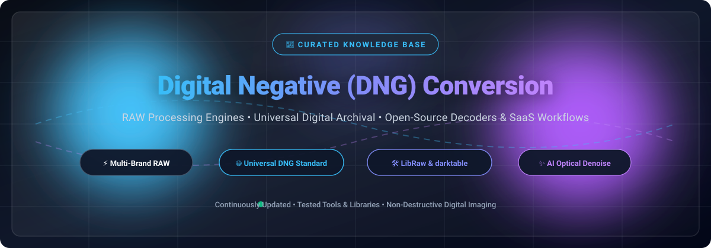

  

# 📸 Awesome Digital Negative (DNG) Conversion

**A comprehensive, curated collection of top SaaS products, desktop editors, and open-source GitHub projects for Camera RAW processing, Digital Negative (DNG) conversion, and universal digital photography archival.**

  
  
  
  
  
  
  

  <em>Everything you need for non-destructive camera RAW workflows, demosaicing, deep optical corrections, batch conversion, and vendor-agnostic DNG preservation.</em>

---

## 📑 Table of Contents

- [🔍 Overview & Scope](#-overview--scope)
- [📈 Sector Overview & Market Dynamics](#-sector-overview--market-dynamics)
- [💼 SaaS & Commercial Platforms](#-saas--commercial-platforms)
- [🛠️ Open-Source GitHub Projects](#️-open-source-github-projects)
- [🤝 How to Contribute](#-how-to-contribute)
- [💖 Support & Sponsorship](#-support--sponsorship)
- [📈 Star History](#-star-history)
- [⚖️ Disclaimer](#️-disclaimer)

---

## 🔍 Overview & Scope

Proprietary camera sensor outputs (Canon `.CR2`/`.CR3`, Nikon `.NEF`, Sony `.ARW`, Fujifilm `.RAF`, Panasonic `.RW2`) store uncompressed raw sensor measurements alongside camera metadata. To prevent proprietary file format obsolescence and ensure cross-platform longevity, **Adobe Digital Negative (DNG)** was introduced as an open standard for raw digital camera files.

This knowledge base tracks:
- 🚀 **High-performance RAW converters**: Converting proprietary sensor formats directly to standard or linear DNG.
- 🔬 **Demosaicing & AI Optical Processing**: De-noising, lens profile corrections, chromatic aberration correction, and dynamic range preservation.
- 🏛️ **Digital Archival Pipelines**: Tools maintaining metadata fidelity (IPTC, EXIF, XMP) for long-term museum and professional photo collections.
- 💻 **SDKs, Scripting Wrappers & Decoders**: C++, Python, and Rust libraries enabling custom automated image processing.

---

## 📈 Sector Overview & Market Dynamics

The global photo editing and RAW image processing software market is estimated at **$14.16 billion to $18.31 billion in 2025/2026**, expanding at a ~9.8% to 10.1% CAGR toward over $37 billion by the mid-2030s, with dedicated RAW processing anchoring the high-value prosumer and professional desktop segment (~$1.2 billion standalone valuation). Market dynamics represent a **moderately concentrated, tiered market structure**: top-tier incumbents (Adobe and Canva/Affinity) dominate scale and cloud distribution, while specialized high-fidelity conversion and optical-correction suites (DxO, Capture One) hold resilient, defensible niche moats among studio professionals, complemented by a robust open-source library and converter ecosystem.

---

## 💼 SaaS & Commercial Platforms

| Platform | Pricing | Free Tier / Trial Limits | Company Scale (Revenue / Valuation) | Description |
| :--- | :--- | :--- | :--- | :--- |
| **[Adobe Camera Raw / Lightroom](https://www.adobe.com/products/photoshop-lightroom-classic.html)** | $11.99/mo (Lightroom Plan) or $19.99/mo (Photography Plan) | 7-day free trial (Full features, credit card required, auto-converts to paid plan unless cancelled) | ~$102.7B Market Cap (~$21.4B Annual Revenue) | Industry-standard RAW processing engine natively supporting DNG conversion, high-fidelity color pipelines, and cloud synchronization. |
| **[Adobe DNG Converter](https://helpx.adobe.com/camera-raw/using/adobe-dng-converter.html)** | Free forever ($0) | Free forever (Full features, no file limit, batch converts proprietary camera RAW to Adobe DNG) | ~$102.7B Market Cap (~$21.4B Annual Revenue) | Adobe's official standalone utility providing free proprietary camera RAW to universal Digital Negative (DNG) batch conversion. |
| **[Affinity Photo](https://affinity.serif.com/photo/)** | Free ($0 core suite via Canva) / Canva Pro from $12.99/mo | Free forever (Full core RAW development studio, unlimited exports; requires free Canva login) | ~$30B - $42B Valuation (~$3.3B+ Annual Revenue) | Professional creative and image editing application featuring an integrated non-destructive RAW Development persona. |
| **[Capture One](https://www.captureone.com/)** | $18.00/mo (annual commitment) or $349 one-time perpetual | 7-day free trial (Full unrestricted access to all editing & tethering features, requires checkout) | ~$234M Valuation / ~$50M Revenue (Acquired/Axcel PE) | Professional-grade RAW converter and tethered workflow studio favored by commercial and fashion photographers. |
| **[PhotoLab (DxO)](https://www.dxo.com/dxo-photolab/)** | $239.99 one-time perpetual license | 30-day free trial (Fully functional Elite edition, no watermarks, no credit card required) | ~$15M - $17M Annual Revenue (~$25M - $50M Valuation) | High-end RAW converter powered by DxO DeepPRIME denoising and optical lab corrections, with direct DNG export. |
| **[DxO PureRAW](https://www.dxo.com/dxo-pureraw/)** | $139.99 one-time perpetual license | 14-day free trial (Full access to DeepPRIME denoising and lens modules; may cap batch volume per run) | ~$15M - $17M Annual Revenue (~$25M - $50M Valuation) | Specialized pre-processing RAW converter that exports cleaned, demosaiced Linear DNGs into any workflow. |
| **[Exposure X](https://exposure.software/)** | $129.00 one-time perpetual license | 30-day free trial (Full feature set, standalone and plug-in modes, no credit card required) | ~$2M - $5M Annual Revenue (Bootstrapped / Private) | Non-destructive RAW photo editor and organizer featuring film emulation presets and DNG support. |
| **[ON1 NoNoise AI / ON1 Photo RAW](https://www.on1.com/)** | $79.99 one-time perpetual or $7.99/mo | 30-day free trial (Fully functional, no credit card required, exports full resolution) | ~$2.2M Annual Revenue (Independent / Bootstrapped) | AI-powered RAW processing and noise reduction software exporting cleaned files in DNG format. |
| **[FastRawViewer](https://www.fastrawviewer.com/)** | $30.00 one-time perpetual license | 30-day free trial (Fully functional without watermarks, extends to 60 days for v1 upgraders) | ~$1M - $3M Annual Revenue (Independent / Bootstrapped) | High-speed RAW culling and technical analysis viewer displaying true RAW histograms and embedded DNG metadata. |
| **[Iridient Developer](https://www.iridientdigital.com/)** | $119.99 one-time perpetual license | Free trial / demo mode (Unlimited duration, full feature access, all exported images contain a watermark) | ~$500K - $1.5M Annual Revenue (Independent / Boutique) | Acclaimed macOS RAW image developer praised for demosaicing precision and flexible DNG handling. |

---

## 🛠️ Open-Source GitHub Projects

| Repository | GitHub_Stars | Description |
| :--- | :--- | :--- |
| **[darktable](https://github.com/darktable-org/darktable)** |  | Powerful open-source photography workflow application and RAW developer with comprehensive DNG import and export pipelines. |
| **[ExifTool](https://github.com/exiftool/exiftool)** |  | Premier command-line application and library for reading, writing, and editing metadata across DNG, RAW, and common media files. |
| **[RawTherapee](https://github.com/RawTherapee/RawTherapee)** |  | Advanced cross-platform RAW image processing program with sophisticated demosaicing, floating-point color, and DNG capabilities. |
| **[LibRaw](https://github.com/LibRaw/LibRaw)** |  | Foundation library for reading and unpacking RAW files from digital cameras, utilized across commercial and open-source converters. |
| **[rawmakase](https://github.com/pch/rawmakase)** |  | Fast, modern, and cross-platform Lightroom-compatible RAW photo editor with modern color pipelines and XMP metadata workflows. |
| **[RawPy](https://github.com/letmaik/rawpy)** |  | Python wrapper around LibRaw enabling fast, scriptable RAW and DNG image processing and extraction in scientific pipelines. |
| **[dnglab](https://github.com/dnglab/dnglab)** |  | Dedicated open-source command-line camera RAW to Digital Negative (DNG) converter written in Rust. |
| **[ART](https://github.com/artraweditor/ART)** |  | Streamlined, actively maintained fork of RawTherapee offering refined tone curve handling and modern RAW/DNG workflow tools. |
| **[rawspeed](https://github.com/darktable-org/rawspeed)** |  | High-performance C++ RAW decoding library maintained by the darktable team for high-speed camera file decompression. |
| **[PiDNG](https://github.com/schoolpost/PiDNG)** |  | Python utility and library to create Adobe DNG RAW files from raw Bayer data, including Raspberry Pi camera modules. |
| **[dcraw](https://github.com/ncruces/dcraw)** |  | Maintained Git repository mirror of Dave Coffin's foundational ANSI C RAW decoding and conversion program. |
| **[tinydng](https://github.com/syoyo/tinydng)** |  | Header-only C++11 Tiny DNG/TIFF loader and writer suitable for embedding in lightweight graphics utilities. |
| **[DNGProcessor](https://github.com/amirzaidi/DNGProcessor)** |  | Open-source mobile/desktop computational DNG processing utility optimizing smartphone sensor captures. |
| **[gpr](https://github.com/gopro/gpr)** |  | GoPro's open-source General Purpose Raw format library built as an extension on top of Adobe's DNG specification. |
| **[raw2dng](https://github.com/Fimagena/raw2dng)** |  | Lightweight Linux command-line utility for converting camera RAW photo files into DNG, TIFF, or JPEG formats. |
| **[RethinkRAW](https://github.com/ncruces/RethinkRAW)** |  | Fast, responsive personal RAW photo organizer and editor powered by Adobe DNG Converter. |
| **[dcraw.js](https://github.com/zfedoran/dcraw.js)** |  | WebAssembly / JavaScript port of dcraw allowing client-side RAW and DNG decoding in web browsers and Node.js. |

---

## 🤝 How to Contribute

Contributions are welcome and appreciated! To maintain high resource quality:
1. 🍴 **Fork the repo** to your personal GitHub account.
2. ✍️ **Add or edit entries** in [README.md](file:///C:/Users/ishan/Documents/Projects/Awesome-Digital-Negative-DNG-Conversion/README.md).
3. 📋 **Include complete data**: tool name, canonical link, specific entry-level tier pricing, explicit free tier or trial duration/limits, and a factual 1–2 sentence description.
4. 🚀 **Submit a Pull Request** describing your additions and changes.

---

## 💖 Support & Sponsorship

Thank you for exploring and using this resource! Maintaining curated, high-quality open-source guides takes continuous research and effort.

If you find this repository helpful for your projects, digital photography, or archival workflow, please consider:
- ⭐ **Starring this repository** to show your appreciation and help others discover it.
- 🔀 **Forking and sharing** it with your developer, photographer, or archivist communities.
- ☕ **Buying a coffee & sponsoring ongoing maintenance** via the [GitHub Sponsors Dashboard](https://github.com/sponsors/ishandutta2007).

Your support is deeply appreciated and directly helps keep this project accurate, independent, and up to date!

---

##  Star History

---

## ⚖️ Disclaimer

- This repository is a **community-curated** reference list and does not constitute an endorsement of any commercial product or vendor.
- Camera RAW file support varies significantly across different camera models and sensor revisions. Always verify compatibility with your specific hardware.
- DNG is an open specification published by Adobe Systems Incorporated; conversion fidelity, metadata preservation, and lens profile support depend on each application's internal demosaicing engine.

---

  <b>Built with ❤️ for photographers, digital archivists, and open-source imaging advocates worldwide.</b>

